# Photon

A physically based path tracer on the GPU, written from scratch in C++20 and CUDA. It has a SAH BVH,
glTF 2.0 PBR materials (GGX microfacets, rough glass), importance sampling of the BSDF, the lights and
HDR environments combined with multiple importance sampling, a glTF loader, an interactive progressive
viewer, and a real-time mode denoised by SVGF.

The integrator is written once, in `__host__ __device__` headers, and runs both as a CUDA kernel and on
all CPU cores. Both use the same random sequences, so the CPU build is a reference for the GPU: their
images agree pixel for pixel (within 0.1% on 99.9–100% of the pixels; see the tests).

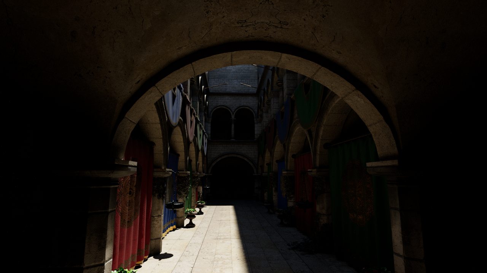

| | |
|---|---|
| 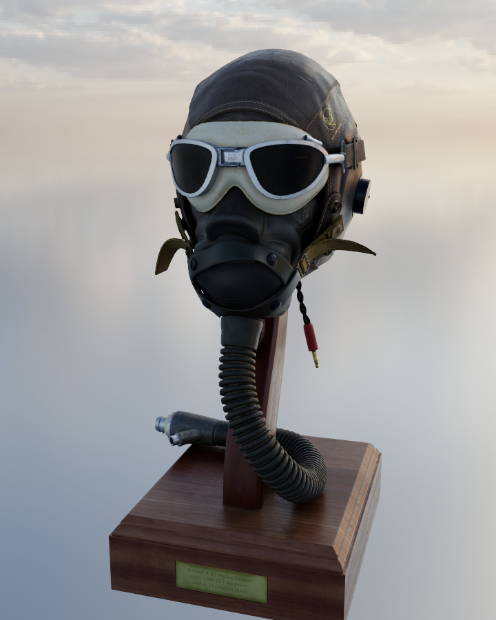 | 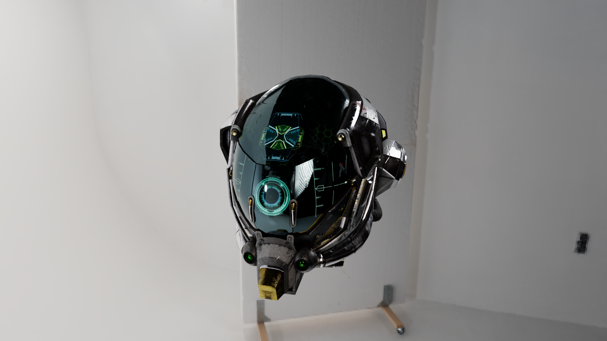 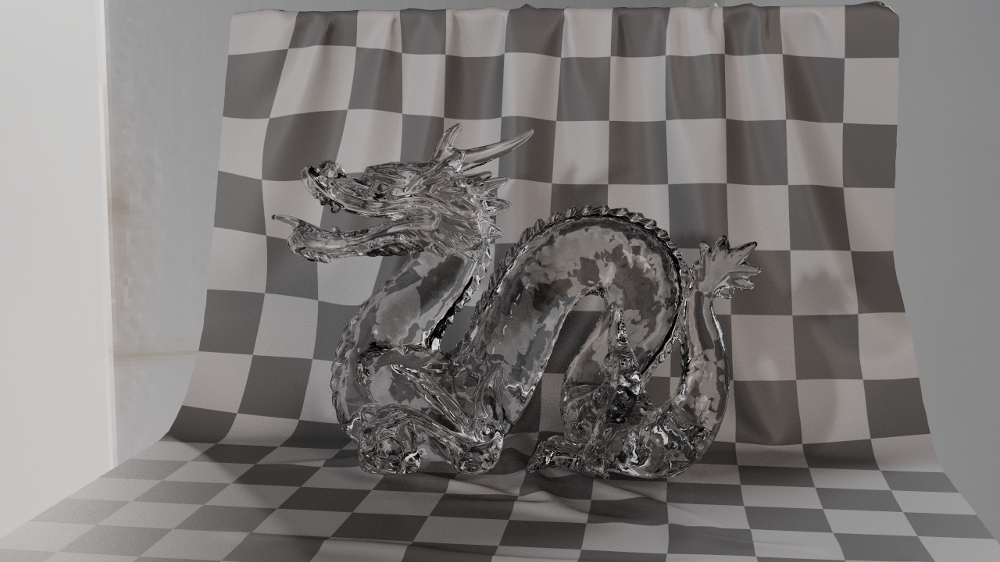 |

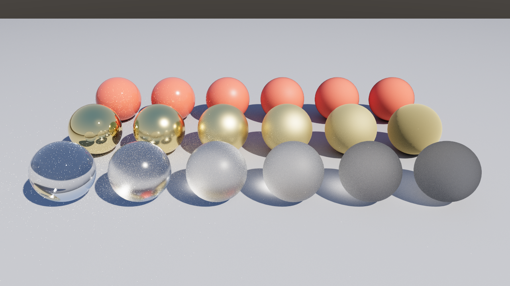
*Top row: dielectric base layer, roughness 0 → 1. Middle: gold, roughness 0 → 1. Bottom: glass, roughness 0 → 1.*

| Cornell box (8192 spp) | Glass (rough and smooth) |
|---|---|
| 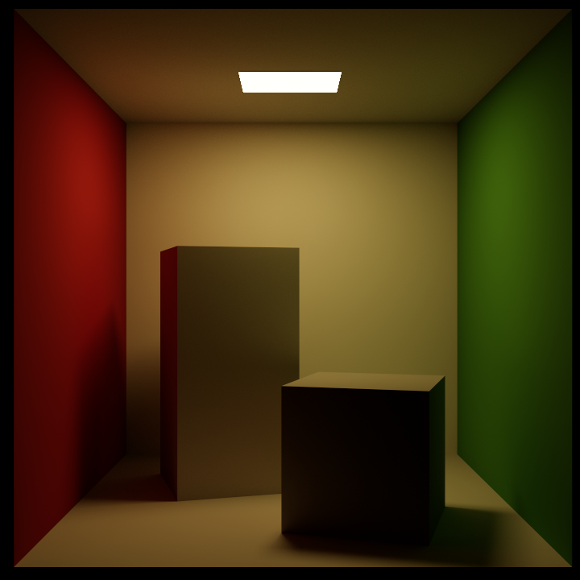 | 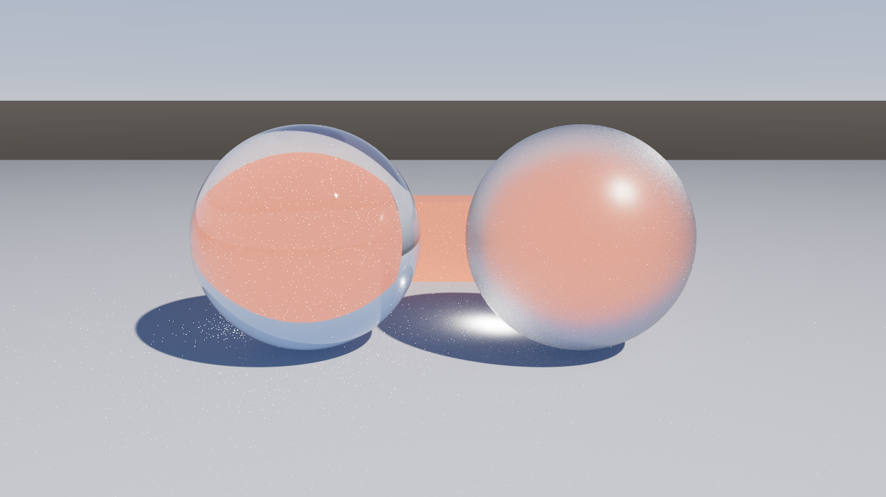 |

## Features

**Acceleration structure** ([src/bvh](src/bvh))
- Binned SAH build (32 bins per axis, leaves of up to 8 triangles), with the large subtrees built in
  parallel threads: 262K triangles (Sponza) in 0.35 s.
- 64-byte nodes that hold the bounds of both children, so one node fetch tests two boxes; stack-based
  traversal visiting the nearest child first; Möller–Trumbore triangle tests; an any-hit variant for
  shadow rays.
- Alpha testing (glTF `MASK` and `BLEND` materials) inside the traversal, for foliage and chains.

**Materials** ([src/render/bsdf.h](src/render/bsdf.h)): glTF 2.0 metallic-roughness, with
`KHR_materials_transmission`, `KHR_materials_ior` and `KHR_materials_emissive_strength`.
- The BSDF is a mixture of three components, weighted by `metallic` and `transmission`:
  - a GGX conductor with Schlick Fresnel tinted by the base color;
  - a dielectric coat over a Lambertian base;
  - a rough dielectric that reflects and refracts (Walter et al. 2007).
- GGX with height-correlated Smith masking. Directions are sampled from the distribution of visible
  normals (Heitz 2018).
- The dielectric coat is energy conserving and reciprocal: its base layer is weighted by
  (1−F(ωo))(1−F(ωi))/(1−F̄). The glTF reference model's (1−F(h)) weight gains energy at grazing angles,
  up to 37% for a glossy plastic, and the BSDF tests catch it.
- Textures: base color, metallic-roughness, normal maps (with tangents computed from the UVs when the
  file has none), and emissive.

**Light transport** ([src/render/integrator.h](src/render/integrator.h))
- Unidirectional path tracing. At each vertex, next event estimation and BSDF sampling are combined
  with the power heuristic.
- Russian roulette after 3 bounces. An optional luminance clamp for indirect light (off by default:
  the renderer is unbiased).
- Light sources:
  - emissive triangles, picked by power with an alias table; textured emitters are estimated from
    their texture, so the black parts of an emissive map are never sampled;
  - `KHR_lights_punctual` point, spot and directional lights;
  - HDR environment maps, sampled by a 2D piecewise-constant distribution over luminance × sin θ.
  The three groups are themselves picked by estimated power.
- Smooth surfaces with a diffuse part (glossy plastic) still sample lights for that part. Mirror-like
  metals and smooth glass rely on BSDF sampling.
- Robust ray offsets (Wächter and Binder 2019). Paths that would leak through the geometry because of
  interpolated shading normals are dropped.
- A thin-lens camera (depth of field). glTF cameras are supported.

**GPU renderer** ([src/render/gpu_renderer.cu](src/render/gpu_renderer.cu))
- One thread per pixel (16×8 blocks) runs the shared integrator, with progressive float accumulation.
- Debug views: albedo, shading normals, depth, per-pixel variance, and a BVH-cost heatmap (nodes
  visited per primary ray).

**SVGF denoiser** ([src/denoise/svgf.cu](src/denoise/svgf.cu)): Schied et al. 2017. The viewer's
real-time mode (path tracing plus SVGF) runs at 25–50 fps at 1600×900 on an RTX 2060.
- Albedo demodulation, keeping the emission seen directly out of the filter.
- Temporal accumulation of color and luminance moments, reprojected with the previous frame's camera.
  History is rejected on material, depth and normal mismatch.
- Variance from the moments, or estimated spatially while the history is short.
- Five à-trous passes with edge-stopping on luminance (scaled by the variance), normals and depth (with
  the depth gradient). The first pass's output becomes the next frame's history.

**glTF 2.0 loader** ([src/scene/gltf.cpp](src/scene/gltf.cpp)): its own JSON parser, no glTF library.
- `.gltf` with external or base64 buffers, and binary `.glb`.
- Accessors with strides and normalized integers (sparse accessors are not supported).
- The node hierarchy (TRS or matrices). Mirrored instances get their winding flipped.
- Triangle lists, strips and fans; samplers; cameras; punctual lights.
- Scenes can also be exported back to glTF (`photon export`).

**Interactive viewer** ([src/app/viewer.cpp](src/app/viewer.cpp)): GLFW, Dear ImGui and OpenGL.
- Progressive mode, with an adaptive number of samples per frame, and a real-time SVGF mode.
- Orbit and fly cameras. All render, SVGF and camera settings are live.
- Ctrl+click picks a material for a live material editor.
- Environment intensity and rotation.
- Drop a `.gltf`/`.glb` or an `.hdr` onto the window to load it. F12 saves PNG and PFM screenshots.

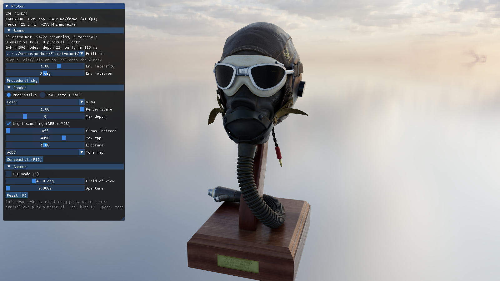

## SVGF

The real-time mode traces one path per pixel per frame and denoises it. The four images below are, from
left to right: the raw 1-spp input, SVGF on the first frame (spatial filter only), SVGF after 32 frames
on a still camera (temporal accumulation), and a 4096-spp reference.

| 1 spp input | SVGF, frame 1 | SVGF, frame 32 | reference, 4096 spp |
|---|---|---|---|
| 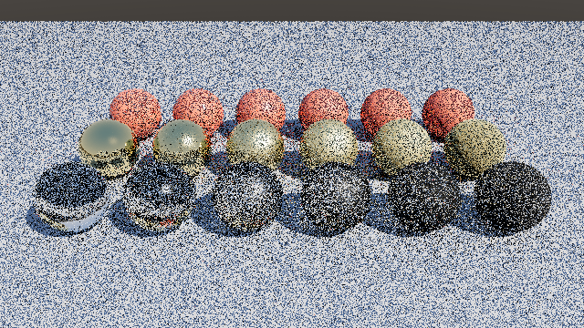 | 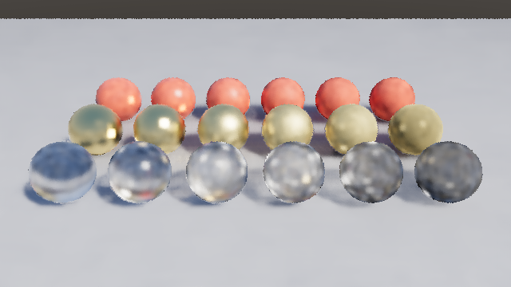 | 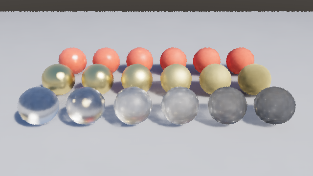 |  |

On the Cornell box, the mean squared error against a 2048-spp reference is 0.0044 at 1 spp. SVGF
lowers it to 0.0018 on the first frame and 0.0014 after 16 frames (`svgf_reduces_error`). With the
camera moving, history is reprojected rather than discarded:

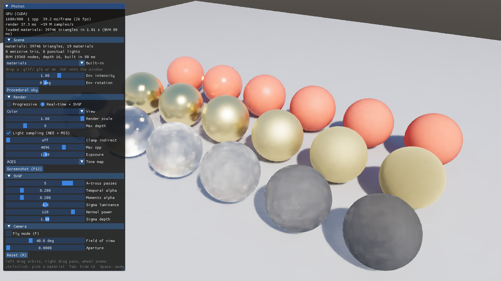

Debug views (albedo, normals, BVH heatmap):

| | | |
|---|---|---|
| 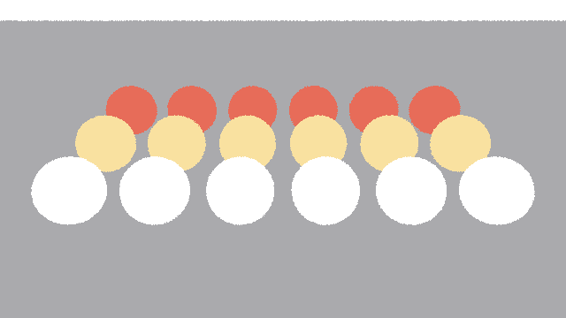 | 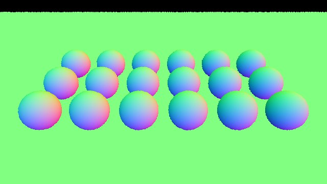 | 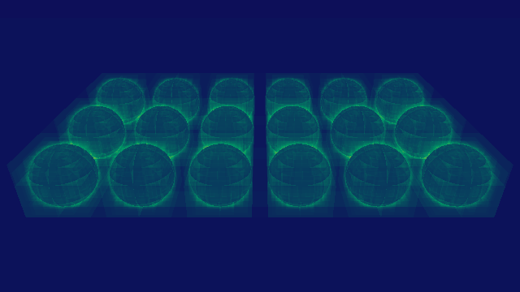 |

## Performance

`photon bench` on an NVIDIA GeForce RTX 2060 laptop GPU (Turing, 30 SMs, no RT cores used) against an
Intel Core i7-10870H (8 cores, 16 threads, the same integrator):

| scene | triangles | BVH build | rays per path | CPU Msamples/s | GPU Msamples/s | GPU Mrays/s | speedup |
|---|---:|---:|---:|---:|---:|---:|---:|
| Cornell box | 36 | 0.1 ms | 2.79 | 3.03 | 121.8 | 339 | 40× |
| materials (18 spheres) | 39,746 | 80 ms | 3.39 | 1.60 | 59.5 | 202 | 37× |
| glass | 18,062 | 65 ms | 3.01 | 2.05 | 75.6 | 227 | 37× |
| Sponza (interior view) | 262,267 | 353 ms | 3.96 | – | 16.5 | 65 | – |

How the numbers are measured:
- A sample is a whole path: up to 8 bounces, each with a shadow ray.
- Rays per path counts camera, bounce and shadow rays.
- Resolution is 960×540.
- Sponza is slower per ray than the other scenes: its rays are incoherent, and every alpha-tested hit
  in the foliage and chains needs a texture lookup.

## Tests

`photon_tests` runs 36 tests in about 15 s. They check the mathematics rather than compare against
golden images.

- **BVH**: closest hits and any-hits agree with brute force over 20,000 random rays, including the
  threaded build on 60K triangles. The tree structure is also checked: every triangle sits in exactly
  one leaf, inside its box.
- **BSDF**:
  - a chi-square test of the sampled directions against `pdf`, over the whole sphere, for 9 materials
    and several view angles (adaptive integration for peaked lobes);
  - `pdf` integrates to the fraction of valid samples;
  - a white furnace for each BSDF: energy is at most 1, and exactly 1 for mirrors and smooth glass,
    once the 1/η² radiance compression of refraction is undone;
  - reciprocity, and finite values at grazing and degenerate angles.
- **Lights**:
  - the environment sampler's density equals its evaluated density;
  - E[1/pdf] = 4π, and E[L/pdf] matches a fine quadrature;
  - the emissive-triangle density matches the density evaluated at BSDF-hit points, which MIS
    depends on;
  - light sampling and hemisphere sampling estimate the same irradiance;
  - point lights follow the inverse square law.
- **Integrator**:
  - the white furnace: a white Lambertian sphere in a white environment is exactly 1 in every pixel;
  - NEE + MIS and pure BSDF sampling converge to the same image;
  - NEE cuts the error by 3.6× at 16 spp;
  - renders are deterministic.
- **GPU**:
  - the CUDA renderer matches the CPU renderer (same pixels, same means);
  - the furnace stays exact on the GPU;
  - SVGF reduces the error and stays finite while the camera moves.
- **glTF**:
  - round trip through `save_gltf`/`load_gltf` (geometry, materials, camera, spot light);
  - node transforms, including mirrored instances;
  - JSON parser edge cases and error reporting;
  - DamagedHelmet, when it has been downloaded.

## Building

Requirements:
- CMake ≥ 3.24 and a C++20 compiler (MSVC 2022+, GCC 11+, Clang 14+).
- For the GPU renderer, the CUDA toolkit (12 or 13). Without it, Photon builds the CPU renderer only.

CMake fetches GLFW 3.4, Dear ImGui 1.91.9b and stb.

```bash
cmake -S . -B build
cmake --build build --config Release --parallel
ctest --test-dir build -C Release --output-on-failure
```

Options:
- `-DPHOTON_CUDA=OFF` builds without CUDA.
- `-DPHOTON_VIEWER=OFF` builds without the window (no GLFW or OpenGL).
- `-DCMAKE_CUDA_ARCHITECTURES=75;86;89` targets other GPUs. The default is the GPU in the machine.

Test assets (not in the repository):

```bash
python scripts/fetch_models.py
```

This fetches DamagedHelmet, FlightHelmet, Sponza and DragonAttenuation from the Khronos glTF sample
assets, and two CC0 HDRIs from Poly Haven.

## Usage

```bash
photon view materials
```

```bash
photon view scenes/models/Sponza/Sponza.gltf --env sky
```

```bash
photon render cornell --spp 4096 --width 720 --height 720 --exposure 1.8 --out cornell.png
```

```bash
photon render scenes/models/DamagedHelmet/DamagedHelmet.glb --env scenes/hdri/studio_small_09_2k.hdr --spp 1024 --out helmet.png
```

```bash
photon render materials --svgf 32 --out denoised.png
```

```bash
photon render materials --view heatmap --out bvh.png
```

```bash
photon bench
```

```bash
photon export glass glass.gltf
```

- `view`: the interactive viewer (`--realtime` starts in the SVGF mode).
- `render`: an offline render; `.pfm` output writes linear HDR.
- `render --svgf N`: the real-time path, N one-sample frames through SVGF.
- `render --view <name>`: a debug view.
- `bench`: CPU vs GPU throughput.
- `export`: writes a scene as glTF.

Scene options:
- `--env <file.hdr|sky>`, `--env-intensity`, `--env-rotation`;
- `--look-from x,y,z`, `--look-at x,y,z`, `--fov`;
- `--aperture` and `--focus` (depth of field);
- `--sun x,y,z` for the procedural sky;
- `--camera i` (the file's cameras).

Render options:
- `--spp`, `--max-depth`, `--exposure`;
- `--tonemap aces|reinhard|linear`;
- `--clamp`, `--no-nee`;
- `--cpu` / `--gpu`, `--threads`, `--seed`.

`photon --help` lists everything.

Viewer controls:
- Orbit camera: left drag orbits, right or middle drag pans, the wheel zooms.
- `F` switches to the fly camera: WASD/QE move, right drag looks around, Shift moves faster.
- Ctrl+click picks a material for the editor.
- Space switches between the progressive and real-time modes. Tab hides the UI. R resets the camera.
  F12 saves a screenshot.

## Layout

```
src/core      vector math, sampling (PCG32, warps), color and tone mapping (shared host/device)
src/bvh       SAH BVH builder
src/scene     scene representation, glTF import/export, JSON parser, images (stb), built-in scenes
src/render    BSDF, lights, traversal, integrator (shared host/device); CPU and CUDA renderers
src/denoise   SVGF (CUDA)
src/app       command line, benchmark and the viewer
tests         unit and statistical tests
scripts       asset download
```

## Limitations

- **Volumes and extra lobes**: no participating media or `KHR_materials_volume` absorption (the
  DragonAttenuation dragon renders as clear glass), and no clearcoat, sheen or specular extensions.
- **Caustics**: they come only from BSDF sampling, so the caustics behind smooth glass are noisy
  (`--clamp` trades bias for less noise).
- **Display path**: the viewer copies the image through the host every frame instead of sharing it with
  OpenGL through CUDA interop, an extra copy per frame.
- **One megakernel**: there is no wavefront path tracing and no use of the RT cores (OptiX). That keeps
  the CPU and GPU code identical.

## References

- Walter, Marschner, Li, Torrance, *Microfacet Models for Refraction through Rough Surfaces*, EGSR 2007.
- Heitz, *Sampling the GGX Distribution of Visible Normals*, JCGT 2018.
- Veach, *Robust Monte Carlo Methods for Light Transport Simulation*, PhD thesis, 1997 (MIS).
- Schied et al., *Spatiotemporal Variance-Guided Filtering*, HPG 2017.
- Wächter, Binder, *A Fast and Robust Method for Avoiding Self-Intersection*, Ray Tracing Gems 2019.
- Duff et al., *Building an Orthonormal Basis, Revisited*, JCGT 2017.
- Pharr, Jakob, Humphreys, *Physically Based Rendering*, 4th edition.
- The Khronos glTF 2.0 specification and sample assets.

## License

MIT. The test models come from the Khronos glTF sample assets under their own licenses (CC BY), and the
HDRIs from Poly Haven (CC0); neither is part of this repository.
